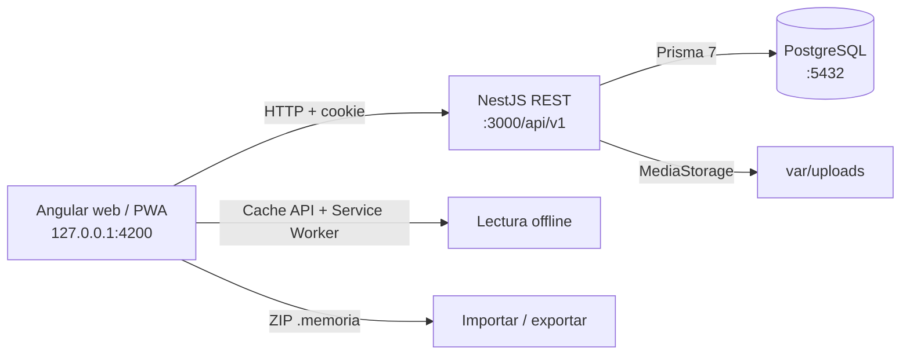

# Memoria Viva

Memoria Viva es una biblioteca personal de colecciones y recuerdos narrados. Cada recuerdo reúne su título, historia, fecha, lugar, personas, fotografías y voces. En **Leer colección**, la foto principal, las miniaturas del carrusel y la foto relacionada con un audio conservan la imagen completa; cuando la proporción no coincide con el marco, quedan márgenes alrededor en vez de recortar la fotografía.

## Cambios recientes

- **Lectura sin recorte:** el visor usa el archivo original de `/content`, conserva el tamaño intrínseco de la imagen y la limita al marco con `contain` en escritorio y móvil. Los carriles de miniaturas y la foto relacionada con cada audio también usan `contain`; las tarjetas de colección y portadas conservan su recorte decorativo.
- **Personas:** `/people` tiene márgenes, contador de registros, formulario de alta y tarjetas responsivas, con edición y eliminación conservadas.
- **Inicio:** `/welcome` explica el propósito del producto, muestra tres ilustraciones SVG locales de ejemplo, describe los pasos iniciales y resuelve preguntas frecuentes sobre fotos, acceso, micrófono y lectura offline.
- **Narraciones:** el alta permite dar título a cada audio, asignar una persona y relacionarlo con una foto; la lectura deja editar metadata, cambiar el vínculo, guardar cambios o eliminar el audio.
- **Diseño móvil:** formularios, navegación, tarjetas de recuerdos y lector reorganizan contenido y controles para pantallas estrechas.

## Manual de uso

### Iniciar la aplicación

Necesitas Node.js 24, npm 11 y Docker Compose. Desde PowerShell en la raíz:

```powershell
Copy-Item .env.example .env
$taskAuthSecret = [Convert]::ToHexString([System.Security.Cryptography.RandomNumberGenerator]::GetBytes(64))
$taskEnvLines = Get-Content .env | ForEach-Object { $_ -replace '^AUTH_SECRET=.*$', "AUTH_SECRET=$taskAuthSecret" }
[System.IO.File]::WriteAllLines((Join-Path (Get-Location) '.env'), $taskEnvLines, [System.Text.UTF8Encoding]::new($false))
npm install
docker compose up -d postgres
npm run db:generate
npm run db:migrate:deploy
```

Abre dos terminales:

```powershell
npm run dev:api
```

```powershell
npm run dev:web
```

Abre <http://localhost:4200>. La API local está en <http://localhost:3000/api/v1>; su estado se consulta en <http://localhost:3000/api/v1/health>.

La primera pantalla ofrece **Crear cuenta** y **Iniciar sesión**. El registro solicita nombre, apellidos, fecha de nacimiento, país, correo y contraseña. Las colecciones, recuerdos, personas y archivos quedan vinculados a la cuenta activa.

### Crear una colección

En **Crear colección**, escribe un título, una descripción opcional y elige álbum, línea de tiempo o colección educativa. La colección es el contenedor desde donde se crean y leen sus recuerdos.

### Crear un recuerdo

Desde la colección, pulsa **Añadir recuerdo**. En el mismo formulario puedes completar:

- Título obligatorio e historia opcional.
- Una fecha y un lugar opcionales.
- Personas relacionadas. Selecciona personas guardadas o escribe un nombre y pulsa **Guardar persona**; la nueva persona se selecciona automáticamente.
- Varias fotografías y varias narraciones. Puedes elegir archivos o grabar voz desde el navegador.

Pulsa **Guardar recuerdo** una sola vez. La aplicación guarda el recuerdo y adjunta los archivos seleccionados; si algún archivo falla, el formulario conserva los que no se subieron para que puedas reintentarlo.

Las fotografías admiten JPEG, PNG, WebP y GIF hasta 25 MB por archivo. Los audios admiten MP3, M4A, WAV, OGG y WebM hasta 100 MB. Grabar voz requiere permiso del micrófono y abrir la aplicación en `localhost` o HTTPS.

### Leer y editar

Pulsa **Leer colección** o selecciona una tarjeta de recuerdo. Usa las flechas o miniaturas para cambiar de foto; el carrusel muestra cada imagen completa. Los controles inferior anterior/siguiente cambian de recuerdo y conservan su posición entre historias. El editor de personas permite cambiar nombres o borrarlas sin eliminar recuerdos ni narraciones.

**Editar recuerdo** abre la edición dentro de la misma lectura. Puedes actualizar título, historia, fecha, lugar y personas; añadir o quitar fotos y narraciones; editar el título, la persona y la foto relacionada de cada audio; y cambiar el orden de las fotos. Pulsa **Guardar cambios** una vez para persistir los cambios de texto y audio y regresar a la lectura. Las cargas y eliminaciones de medios se aplican al completarse.

### Guardar sin conexión o exportar

En **Más acciones** hay dos opciones distintas:

- **Guardar para leer sin conexión** descarga datos, portada y medios a este navegador/dispositivo. Sirve para abrir la colección sin red en ese mismo dispositivo. **Quitar copia de este dispositivo** libera ese almacenamiento y no borra la colección del servidor. Al cerrar sesión, se limpian las copias del navegador.
- **Crear archivo portátil `.memoria`** descarga un archivo independiente que puedes guardar, respaldar o trasladar a otro equipo. No es una descarga offline del navegador.

Para leer offline, instala la PWA desde el navegador y descarga la colección mientras hay conexión. La edición y sincronización offline no están incluidas; los cambios requieren la API local.

Para restaurar un paquete, abre **Importar .memoria** en la barra superior y selecciona el archivo. La importación verifica sus archivos y crea una colección nueva; no fusiona ni reemplaza contenido existente. Se admiten paquetes de versión 1 y 2 (500 MB máximo).

La versión 2 contiene:

```text
manifest.json       versión y SHA-256 de cada medio
collection.json     título, tipo, descripción y portada opcional
events.json         recuerdos, relaciones, fotos y narraciones
media/<uuid>        fotografías y audios originales
```

Los paquetes v1 anteriores que incluyen `pages.json` siguen siendo importables; sus páginas antiguas se ignoran en esta versión simplificada.

## Archivos locales

Los originales y miniaturas se guardan fuera de PostgreSQL:

```text
var/uploads/
├── photos/
├── audio/
└── thumbnails/
```

PostgreSQL conserva metadatos y relaciones. Incluye `var/uploads/` y la base de datos en una misma copia de seguridad.

## Rutas principales

| Ruta | Pantalla |
| --- | --- |
| `/welcome` | Inicio |
| `/register` | Crear cuenta |
| `/login` | Iniciar sesión |
| `/library` | Biblioteca y búsqueda por texto |
| `/collections/new` | Crear colección |
| `/collections/:id` | Recuerdos, acciones y estado offline |
| `/collections/:id/edit` | Editar datos de colección |
| `/collections/:id/read` | Leer y editar recuerdos en contexto |
| `/collections/:id/read?create=true` | Crear un recuerdo en el lector de esa colección |
| `/portability` | Importar `.memoria` |

## API REST principal

Prefijo `/api/v1`.

| Método | Ruta | Uso |
| --- | --- | --- |
| `GET` | `/health` | Estado de API y PostgreSQL |
| `POST` | `/auth/register` | Crear cuenta e iniciar sesión |
| `POST` | `/auth/login` | Iniciar sesión |
| `GET` | `/auth/me` | Consultar sesión activa |
| `POST` | `/auth/logout` | Cerrar sesión |
| `GET/POST` | `/collections` | Listar o crear colecciones |
| `GET/PATCH/DELETE` | `/collections/:id` | Consultar, actualizar o borrar colección |
| `POST/DELETE` | `/collections/:id/events` y `/collections/:id/events/:eventId` | Añadir o quitar recuerdo |
| `PATCH` | `/collections/:id/events/order` | Guardar orden manual |
| `GET/POST` | `/events` | Buscar o crear recuerdos |
| `GET/PATCH/DELETE` | `/events/:id` | Consultar, actualizar o borrar recuerdo |
| `GET/POST` | `/people` | Listar o guardar personas |
| `PATCH/DELETE` | `/people/:id` | Editar o borrar una persona sin borrar recuerdos ni audios |
| `POST/DELETE` | `/collections/:id/cover` | Guardar o quitar portada |
| `POST/DELETE/PATCH` | `/events/:id/photos` | Subir, quitar o actualizar foto |
| `PATCH` | `/events/:id/photos/order` | Ordenar fotos |
| `POST` | `/events/:id/narrations` | Añadir narración |
| `PATCH/DELETE` | `/events/:id/narrations/:narrationId` | Editar o eliminar narración |
| `PATCH` | `/events/:id/narrations/order` | Ordenar narraciones |
| `GET` | `/media/assets/:id/content` | Servir original |
| `GET` | `/media/assets/:id/thumbnail` | Servir miniatura |

## Configuración local

`.env.example` es la plantilla versionada. Mantén `.env` privado. Variables principales: `POSTGRES_DB`, `POSTGRES_USER`, `POSTGRES_PASSWORD`, `POSTGRES_PORT`, `DATABASE_URL`, `PORT`, `CORS_ORIGIN`, `AUTH_SECRET` (secreto aleatorio de al menos 32 caracteres) y `MEDIA_ROOT` (`../../var/uploads`).

Para cambios de Prisma, usa `npm run db:migrate:dev` y `npm run db:generate`. Para compilar:

```powershell
npm run build:api
npm run build:web
```

## Alcance

V1 incluye cuentas con datos separados por usuario, colecciones con portada, recuerdos con carrusel de fotos y narraciones editables, personas, diseño adaptable, lectura offline y portabilidad. El editor tipo Canva/páginas, colaboración, nube AWS, APK Capacitor, transcripción automática e IA quedan fuera. La especificación actualizada está en [docs/MVP_SPEC.md](docs/MVP_SPEC.md); las decisiones y sprints, en [docs/PLAN_DESARROLLO.md](docs/PLAN_DESARROLLO.md).

## Guía para desarrollo y continuidad

Esta sección describe el código que existe hoy. La solución activa es una aplicación web Angular y una API NestJS conectada a PostgreSQL local. La web y la API se ejecutan en el host; Docker Compose levanta PostgreSQL. Aún no hay servicios AWS ni una aplicación Capacitor/Android configurada.

### Arquitectura y límites entre capas



Responsabilidades principales:

- **`apps/web/src/app/features/`** contiene pantallas y flujos de producto. Cada página suele tener su componente TypeScript, plantilla HTML y SCSS.
- **`apps/web/src/app/core/api/`** centraliza las llamadas REST, la URL base y el envío de cookies.
- **`apps/web/src/app/core/auth/`** conserva el perfil de sesión en el cliente y protege las rutas autenticadas.
- **`apps/web/src/app/core/offline/`** descarga colecciones y medios al almacenamiento del navegador para lectura sin conexión.
- **`apps/web/src/app/core/archive/`** construye y valida los archivos portátiles `.memoria`.
- **`apps/api/src/modules/`** organiza la API por dominio. Los controladores declaran rutas, los DTO validan entradas y los servicios aplican reglas y consultas Prisma.
- **`apps/api/src/prisma/`** configura el cliente de PostgreSQL. **`apps/api/prisma/`** contiene el esquema y las migraciones SQL versionadas.
- **`apps/api/src/modules/media/media-storage.ts`** define el contrato de almacenamiento. `local-media-storage.service.ts` es su implementación local; `MediaModule` la registra con el token `MEDIA_STORAGE`.

Mapa de carpetas relevante:

```text
.
├── apps/
│   ├── api/
│   │   ├── prisma/
│   │   │   ├── schema.prisma
│   │   │   └── migrations/
│   │   └── src/
│   │       ├── main.ts                 # prefijo /api/v1, CORS, validación y puerto
│   │       ├── app.module.ts           # módulos y guardia de autenticación global
│   │       ├── modules/
│   │       │   ├── auth/               # registro, login, cookie y JWT
│   │       │   ├── collections/        # colecciones y orden de recuerdos
│   │       │   ├── events/             # recuerdos y búsqueda
│   │       │   ├── health/             # API + base de datos
│   │       │   ├── media/              # fotos, audio, portadas y archivos
│   │       │   └── people/             # catálogo por cuenta
│   │       └── prisma/                 # servicio y módulo Prisma
│   └── web/
│       ├── public/                     # manifest, iconos e ilustraciones públicas
│       └── src/app/
│           ├── app.routes.ts           # rutas Angular y guardia
│           ├── core/
│           │   ├── api/                # cliente HTTP y URL de API
│           │   ├── archive/            # `.memoria`
│           │   ├── auth/               # sesión y protección de páginas
│           │   └── offline/            # caché de colecciones y medios
│           └── features/
│               ├── auth/               # bienvenida, registro e inicio de sesión
│               ├── collections/        # biblioteca de colección, formulario y detalle
│               ├── events/             # alta conjunta y vista de recuerdo independiente
│               ├── import-export/      # pantalla de importación
│               ├── library/            # biblioteca del usuario
│               ├── people/             # personas
│               └── reader/             # lectura de colección y edición en contexto
├── docs/                               # alcance MVP y plan de sprints
├── var/uploads/                        # archivos locales; no se versionan
├── docker-compose.yml                  # solo PostgreSQL
├── .env.example                        # plantilla sin secretos
└── package.json                        # workspaces npm y comandos raíz
```

Algunos modelos antiguos siguen en `schema.prisma` por compatibilidad de la base existente: `Page`, `PageElement`, `Category`, `Tag`, relaciones de categorías/etiquetas y columnas de precisión/fin de fecha/coordenadas. No son funciones visibles del MVP actual. No borres esos modelos ni edites migraciones ya aplicadas sin preparar una migración de datos y comprobar los archivos `.memoria` que se importan.

### Tecnologías y versiones del repositorio

Las versiones exactas se fijan en `package-lock.json`; las dependencias principales declaradas son:

| Área | Tecnología actual | Uso |
| --- | --- | --- |
| Web | Angular 22, TypeScript 6, RxJS 7.8 | SPA, rutas y formularios |
| Componentes | Angular Material 22, Angular CDK 22 | formularios, tarjetas, menús y controles |
| PWA | `@angular/service-worker` | caché del shell y recursos en build de producción |
| API | NestJS 12, Express 5 | API REST modular |
| Validación | `class-validator`, `class-transformer` | validar DTO en el límite HTTP |
| Persistencia | Prisma 7.10, PostgreSQL 18 (imagen Docker `postgres:18-alpine`) | modelo relacional y migraciones |
| Imágenes | `sharp` | miniaturas WebP locales |
| Archivo portátil | `fflate` | ZIP `.memoria` en navegador |
| Contenedores | Docker Compose | PostgreSQL local con volumen persistente |

El README asume Node.js 24 y npm 11. Si cambias versiones, actualiza el lockfile y vuelve a compilar ambos workspaces. Angular PWA y los SVG de ejemplo se sirven desde `apps/web/public`; Capacitor, APK, S3, RDS y CloudFront no están configurados.

### Puertos, URL y variables de entorno

| Servicio | Dirección local | Configuración |
| --- | --- | --- |
| Angular `ng serve` | `http://127.0.0.1:4200` | `apps/web/package.json` |
| NestJS | `http://localhost:3000/api/v1` | `PORT` y prefijo global en `apps/api/src/main.ts` |
| Salud API/DB | `http://localhost:3000/api/v1/health` | endpoint público |
| PostgreSQL | `localhost:5432` | `POSTGRES_PORT` en Compose |
| Prisma Studio | normalmente `http://localhost:5555` | `npm run db:studio` |

La plantilla raíz `.env.example` se copia a `.env` en la raíz. Variables:

| Variable | Función |
| --- | --- |
| `POSTGRES_DB`, `POSTGRES_USER`, `POSTGRES_PASSWORD` | crean la base y usuario de desarrollo del contenedor |
| `POSTGRES_PORT` | publica el puerto 5432 del contenedor en el host |
| `DATABASE_URL` | conexión PostgreSQL usada por Prisma |
| `PORT` | puerto HTTP de NestJS; default 3000 |
| `CORS_ORIGIN` | lista separada por comas de orígenes web autorizados |
| `AUTH_SECRET` | secreto HMAC para firmar sesiones; debe tener al menos 32 caracteres |
| `MEDIA_ROOT` | raíz local para archivos, relativa al directorio de trabajo de la API |

`API_BASE_URL` se construye en `apps/web/src/app/core/api/api-base-url.ts` con el hostname actual del navegador y el puerto `3000`. La API permite credenciales CORS y el interceptor Angular envía cookies. Para desplegar detrás de HTTPS o en un dominio diferente, configura una URL de API por entorno y cookies `secure`; el código actual está pensado para desarrollo local HTTP.

### Preparar y arrancar el proyecto

Desde PowerShell, en la raíz del repositorio:

```powershell
Copy-Item .env.example .env
$secret = [Convert]::ToHexString([System.Security.Cryptography.RandomNumberGenerator]::GetBytes(64))
$lines = Get-Content .env | ForEach-Object { $_ -replace '^AUTH_SECRET=.*$', "AUTH_SECRET=$secret" }
[System.IO.File]::WriteAllLines((Join-Path (Get-Location) '.env'), $lines, [System.Text.UTF8Encoding]::new($false))
npm install
docker compose up -d postgres
npm run db:generate
npm run db:migrate:deploy
```

Mantén `.env` fuera de Git. No publiques el valor de `AUTH_SECRET` ni credenciales locales. Abre dos terminales en la raíz y deja ambos procesos ejecutándose:

```powershell
npm run dev:api
```

```powershell
npm run dev:web
```

Abre `http://127.0.0.1:4200`. Si se modifican recursos dentro de `apps/web/public`, reinicia `ng serve` si no aparecen; es posible que un proceso existente no incorpore recursos públicos nuevos automáticamente.

Para probar desde un teléfono conectado a la misma red, el servidor Angular debe escuchar en la interfaz LAN, no solo en `127.0.0.1`; arráncalo temporalmente desde `apps/web` con `npx ng serve --host 0.0.0.0`. Añade `http://<IP-del-equipo>:4200` a `CORS_ORIGIN`, reinicia la API y abre `http://<IP-del-equipo>:4200` en el teléfono. `API_BASE_URL` usa ese hostname y por ello buscará la API en el puerto 3000 del mismo equipo. Windows Firewall debe permitir ambos puertos en la red privada. Micrófono y Service Worker requieren HTTPS en un teléfono; por HTTP en una dirección IP LAN el navegador puede bloquearlos.

### Flujo funcional y conexión entre archivos

1. **Sesión:** `welcome-page.component` enlaza a registro/login. `AuthService` llama a `MemoriaApiService`; NestJS emite la cookie HTTP-only `memoria_viva_session`, válida siete días. `credentials.interceptor.ts` envía credenciales en cada request. `authGuard` consulta `/auth/me` para rutas protegidas.
2. **Biblioteca:** `library-page` carga `GET /collections`. El usuario crea o abre una colección. La API filtra por `ownerId` de la cookie, no por un identificador enviado por la interfaz.
3. **Alta de recuerdo:** desde la colección o su lector, el botón **Añadir recuerdo** abre `/collections/:id/read?create=true`. `reader-page.component.ts/html` cambia a modo de creación dentro del mismo marco de lectura. El área izquierda muestra fotos seleccionadas completas y en carrusel; el área derecha reúne título, historia, fecha, lugar, personas y audios. El flujo no abre una pantalla de formulario separada.
4. **Guardado de medios:** al pulsar **Guardar recuerdo**, el lector crea primero el recuerdo (`POST /events`) para obtener su UUID. Después sube fotos (`POST /events/:eventId/photos`) y conserva el mapa entre IDs de vista previa y `MediaAsset.id`. Finalmente sube audios (`POST /events/:eventId/narrations`) con el identificador de la foto relacionada. Si un archivo falla, el recuerdo creado y los archivos pendientes se mantienen en la misma vista para reintentar con **Completar recuerdo**. Cuando todo termina, el lector cambia a modo lectura y selecciona el recuerdo nuevo.
5. **Lectura:** `reader-page.component.ts/html` obtiene la colección con sus recuerdos, navega entre eventos y fotos y reproduce narraciones. El marco grande usa el original `/media/assets/:id/content`; carrusel y fotos pequeñas usan miniaturas solo como vistas auxiliares. Una miniatura vinculada a una narración selecciona esa foto en el marco grande.
6. **Edición:** desde el lector, **Editar recuerdo** cambia al modo de edición de esa misma historia. Título, historia, fecha, lugar y personas se actualizan con `PATCH /events/:id`. Cada narración existente se modifica con `PATCH /events/:eventId/narrations/:narrationId`, con título, persona, transcripción y foto relacionada. **Guardar cambios** vuelve a lectura. Las subidas y eliminaciones de medios se aplican al terminar la llamada correspondiente.
7. **Personas:** `people-page.component` mantiene el catálogo por cuenta con `GET/POST/PATCH/DELETE /people`. Borrar una persona elimina sus relaciones; conserva el recuerdo y el audio.

### Modelo de datos activo

- **`User`** tiene colecciones, recuerdos y personas propias. El email es único; la contraseña solo se almacena como hash scrypt.
- **`Collection`** tiene tipo `ALBUM`, `TIMELINE` o `EDUCATIONAL`, descripción, propietario y una portada opcional.
- **`CollectionItem`** vincula colección y recuerdo con posición. Un recuerdo puede aparecer en más de una colección.
- **`Event`** representa el recuerdo: título, descripción, `dateStart`, `locationName` y propietario.
- **`EventPhoto`** vincula una foto de `MediaAsset` al recuerdo, guarda posición y caption.
- **`Narration`** vincula un audio de `MediaAsset` al recuerdo, guarda título, transcripción opcional, posición, persona narradora opcional y foto relacionada opcional.
- **`EventPerson`** conecta personas relacionadas con recuerdos.
- **`MediaAsset`** guarda metadatos, tamaño, mime type, SHA-256 y claves de almacenamiento; los bytes viven fuera de PostgreSQL.

Relaciones y límites de acceso están en `apps/api/prisma/schema.prisma`. Las consultas de cada service reciben `request.user.id` y filtran por el dueño. Mantén esa verificación en cualquier endpoint nuevo, incluidos cambios de foto, audio y portadas.

### Almacenamiento multimedia

La interfaz del navegador manda archivos multipart con el campo `file`. El controlador valida MIME y límites antes de llamar a `MediaService`:

- Fotos: JPEG, PNG, WebP o GIF; máximo 25 MB.
- Audio: MP4/M4A, MP3, WAV, WebM u OGG; máximo 100 MB.
- `MediaService.saveAsset` crea un UUID, calcula SHA-256, guarda el original y registra su metadata.
- Para fotos, `sharp` produce una miniatura WebP de hasta 720 × 720 píxeles. Original y miniatura se guardan en `var/uploads/photos/` y `var/uploads/thumbnails/`; audios, en `var/uploads/audio/`.
- Las rutas físicas no se guardan en la base como rutas del sistema; se guardan `storageKey` y `thumbnailStorageKey` relativos al proveedor.
- `LocalMediaStorageService` comprueba que la clave no escape de `MEDIA_ROOT`. Los endpoints protegidos de contenido sirven el original o la miniatura según la ruta.
- Si se migra a S3, conserva el contrato `MediaStorage` (`put`, `open`, `delete`), añade un provider y ajusta la forma de streaming/URL firmada sin cambiar los DTO de eventos.

La etapa principal de lectura **no debe usar `object-fit: cover` ni endpoints thumbnail**. El `` está limitado con `width/height:auto` y `max-width/max-height:100%`, `object-fit:contain` y centrado sobre un fondo que funciona como marco. Las miniaturas del carrusel también usan `contain`; una foto panorámica o vertical puede dejar espacio visible dentro del marco, pero su contenido completo no se recorta.

### PWA y modo offline

- `apps/web/src/app/app.config.ts` registra `ngsw-worker.js` solo cuando Angular no está en modo desarrollo.
- `apps/web/ngsw-config.json` precarga el shell y administra los recursos estáticos. Los recursos de `public/illustrations` forman parte del build.
- Para una copia offline, `OfflineCollectionService.download()` obtiene la colección, cada recuerdo, sus originales, miniaturas y audios; usa Cache API y mantiene el índice/URLs de cada copia en `localStorage`.
- `MemoriaApiService.cachedGet()` usa la respuesta de colección/recuerdo cacheada si la API no responde. Las URLs Blob permiten mostrar y reproducir medios descargados.
- Al cerrar sesión se eliminan los caches privados y objetos Blob de la sesión. `remove(collectionId)` quita la copia de ese dispositivo sin borrar la colección del servidor.
- Offline cubre **lectura**. Crear/editar no sincroniza cambios sin red. La PWA de producción necesita HTTPS; `localhost` es excepción para desarrollo.

### Formato `.memoria`

`MemoriaArchiveService` construye el ZIP en el navegador con `fflate`. El paquete actual de exportación es v2:

```text
familia.memoria                 # ZIP sin compresión (renombrado)
├── manifest.json               # format/version, archivos, tamaño y SHA-256
├── collection.json             # nombre, tipo, descripción y portada
├── events.json                 # recuerdos, personas, fotos, narraciones y posiciones
└── media/<uuid>                # bytes originales de fotos y audios
```

La importación verifica extensión, versión, tipo, rutas internas, duplicados, límites y hashes antes de crear la colección. Crea una copia nueva con ` (importada)` en el nombre; si falla a mitad de camino ejecuta rollback best-effort. Límite del archivo comprimido: 500 MB. Los ZIP v1 con páginas antiguas se aceptan e ignoran sus páginas; no se exportan páginas en v2.

### API REST y autenticación

Prefijo común: `http://localhost:3000/api/v1`. Salvo `/health`, los controladores están protegidos por `JwtAuthGuard`, registrado como guardia global. El JWT HS256 va en la cookie HTTP-only `memoria_viva_session` (7 días). El backend valida DTO con `whitelist`, rechaza campos desconocidos y convierte tipos con `ValidationPipe` global.

| Método | Endpoint | Propósito |
| --- | --- | --- |
| `GET` | `/health` | estado de API y conexión PostgreSQL |
| `POST` | `/auth/register` | crear cuenta y sesión |
| `POST` | `/auth/login` | iniciar sesión |
| `GET` | `/auth/me` | perfil de la sesión |
| `POST` | `/auth/logout` | invalidar cookie del cliente |
| `GET`, `POST` | `/collections` | listar y crear colecciones |
| `GET`, `PATCH`, `DELETE` | `/collections/:id` | leer, editar y eliminar colección |
| `POST` | `/collections/:id/events` | vincular recuerdo existente |
| `DELETE` | `/collections/:id/events/:eventId` | quitar vínculo de colección |
| `PATCH` | `/collections/:id/events/order` | cambiar orden |
| `POST`, `GET` | `/events` | crear y listar/buscar recuerdos; query `search`, opcional `collectionId` |
| `GET`, `PATCH`, `DELETE` | `/events/:id` | leer, actualizar y eliminar recuerdo |
| `GET`, `POST` | `/people` | listar/crear personas |
| `PATCH`, `DELETE` | `/people/:id` | cambiar nombre o eliminar persona |
| `POST` | `/events/:eventId/photos` | subir foto; multipart `file`, opcional `caption` |
| `PATCH` | `/events/:eventId/photos/order` | ordenar fotos con `{ "ids": ["..."] }` |
| `PATCH`, `DELETE` | `/events/:eventId/photos/:photoId` | editar caption o quitar foto |
| `POST` | `/events/:eventId/narrations` | subir audio y metadata multipart |
| `PATCH` | `/events/:eventId/narrations/order` | ordenar narraciones |
| `PATCH`, `DELETE` | `/events/:eventId/narrations/:narrationId` | editar metadata o quitar audio |
| `POST`, `DELETE` | `/collections/:collectionId/cover` | subir o quitar portada |
| `GET` | `/media/assets/:id/content` | servir original de una foto/audio |
| `GET` | `/media/assets/:id/thumbnail` | servir miniatura de foto |

La fuente de rutas y DTO es `apps/api/src/modules/<dominio>/*.controller.ts` y su carpeta `dto/`. Al agregar endpoint, actualizar este inventario y el cliente `MemoriaApiService`.

### Prisma y cambios de esquema

`apps/api/prisma/schema.prisma` es la fuente del modelo. Prisma 7 carga URL de conexión desde `apps/api/prisma.config.ts`; ese archivo carga el `.env` raíz. El cliente generado va a `apps/api/src/generated/prisma/` y está ignorado en Git.

Migraciones versionadas actuales:

1. `20261031000000_init`: estructura base de colecciones, recuerdos, medios y relaciones.
2. `20261101000000_photo_thumbnails`: clave de miniatura de fotos.
3. `20261101010000_auth_and_collection_cover`: usuarios, propietario en datos, portada y claves/índices.

Flujo al cambiar modelo:

```powershell
npm run db:migrate:dev   # crea/aplica migración de desarrollo
npm run db:generate      # regenera tipos y cliente
npm run build:api
```

En una base ya creada o en despliegues se usa `npm run db:migrate:deploy`, no `migrate dev`. Incluye el nuevo SQL generado y el cambio de Prisma en el mismo commit. No borres el volumen de Compose como forma de “aplicar” una migración: `docker compose down -v` elimina la base local.

### Comandos y ciclo de trabajo

| Comando | Acción |
| --- | --- |
| `npm install` | instala ambos workspaces según lockfile |
| `docker compose up -d postgres` | inicia PostgreSQL persistente |
| `docker compose ps` | muestra estado/health del contenedor |
| `docker compose logs -f postgres` | muestra log de PostgreSQL |
| `npm run db:generate` | genera cliente Prisma |
| `npm run db:migrate:dev` | migración local de desarrollo |
| `npm run db:migrate:deploy` | aplica migraciones ya versionadas |
| `npm run db:studio` | abre Prisma Studio |
| `npm run dev:api` | API NestJS en watch |
| `npm run dev:web` | Angular dev server |
| `npm run build:api` | compila la API |
| `npm run build:web` | compila Angular y Service Worker de producción |

Recomendación para continuar el MVP: primero confirma el comportamiento y modifica el componente de `features`; luego ajusta DTO/controller/service Prisma solo si el dato o la regla lo requieren; añade migración versionada cuando cambie el esquema; actualiza `MemoriaApiService`, manual y rutas API; al final compila ambos workspaces y recorre el flujo afectado en navegador. No se incluyen suites de prueba automatizadas en este repositorio todavía.

### Decisiones que deben mantenerse

- El recuerdo se centra en título, historia, fecha sencilla, lugar y personas; no agrega taxonomías o precisión de fecha al flujo actual.
- Cada recuerdo puede tener varias fotos y varias narraciones. Cada narración puede apuntar a una foto del mismo recuerdo.
- El lector muestra una foto completa por vez y navega recuerdos con controles estables. **Solo las portadas/tarjetas** usan recorte de tipo cover; no apliques ese estilo al marco principal.
- Alta y edición de narraciones conservan títulos explícitos; evitar sustituirlos por “Voz 1”.
- Colecciones, recuerdos, personas y medios siempre se consultan bajo la cuenta autenticada.
- La portabilidad `.memoria` es copia portable; “Guardar sin conexión” es caché en el dispositivo actual. No son el mismo flujo.
- Mantener este MVP sin editor tipo Canva, colaboración, permisos compartidos, IA, transcripción, Capacitor/APK ni proveedor AWS.

## Solución de problemas

- **La biblioteca no carga:** confirma `docker compose ps`, deja `npm run dev:api` activo y abre `/api/v1/health`.
- **Angular no conecta con la API:** usa `localhost:4200` o `127.0.0.1:4200`; revisa el puerto 3000 y `CORS_ORIGIN`.
- **No se guarda un medio:** revisa el tamaño, formato y permisos de escritura en `var/uploads/`.
- **No puedes grabar voz:** concede acceso al micrófono y usa `localhost` o HTTPS.
- **No abre una colección sin conexión:** descárgala completamente mientras estás conectado y revisa que el navegador conserve sus datos del sitio.
