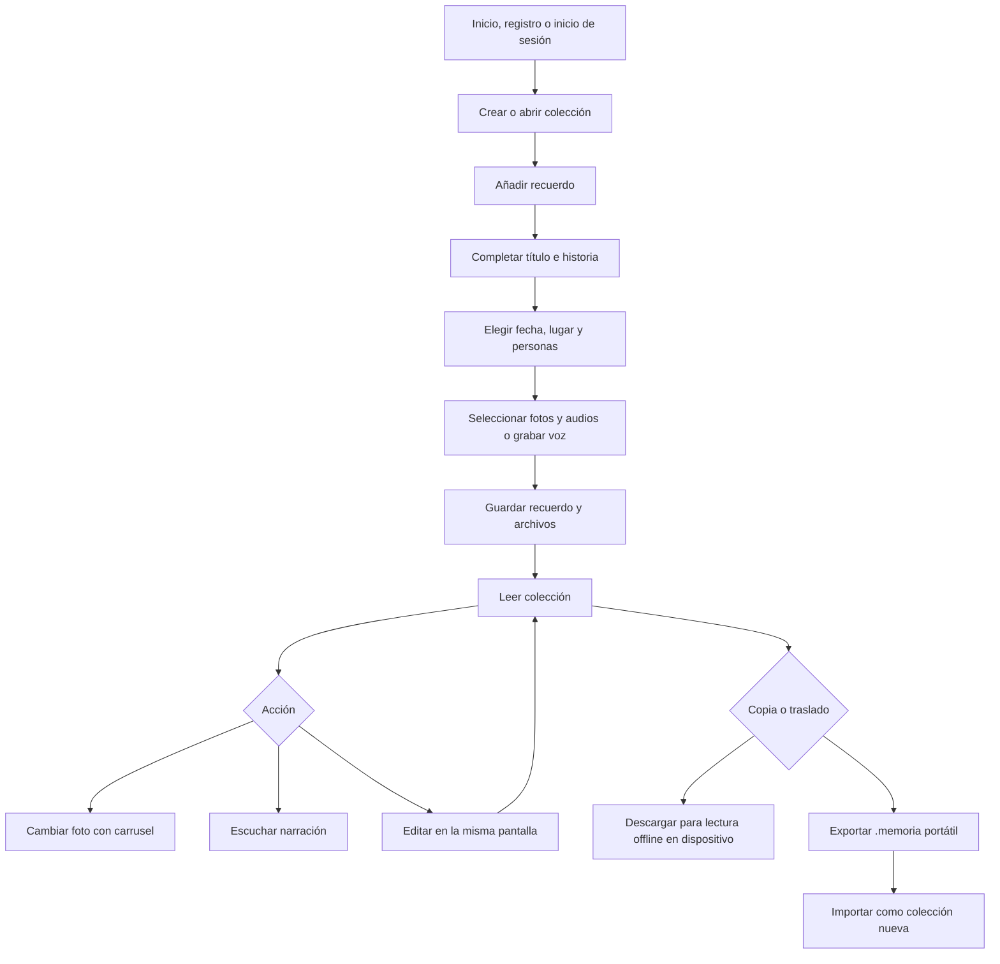

# Memoria Viva — alcance congelado de V1.0

**Estado:** alcance actualizado.  
**Objetivo:** crear colecciones de recuerdos narrados, adjuntar todo en un solo flujo y leer cada momento con sus fotos completas, historia y voces.

## 1. Definición de V1.0

Aplicación personal y responsiva para navegador de escritorio, tablet y teléfono. La PWA puede instalarse y guardar colecciones para lectura offline. Angular consume una API NestJS; PostgreSQL conserva metadatos y los medios se guardan en disco local.

Cada usuario registra una cuenta y accede con correo y contraseña. Sus colecciones, recuerdos, personas y medios quedan aislados de otras cuentas. Un recuerdo se crea dentro de una colección y contiene título, historia/descripción opcional, una fecha opcional, lugar opcional, personas relacionadas, cero o más fotos y cero o más narraciones. Los archivos se adjuntan en el mismo formulario que los datos. En lectura, varias fotos se recorren con carrusel de una foto completa por vez. La edición se abre dentro del lector; **Guardar cambios** persiste los textos y ajustes de cada narración y regresa a la lectura.

### Reglas cerradas

- Una biblioteca por cuenta; registro e inicio de sesión forman parte de V1. No hay colaboración.
- Colección obligatoria para crear un recuerdo desde la interfaz.
- Personas se guardan por cuenta; el usuario puede añadir, editar o borrar una desde su catálogo y asociarla con el recuerdo. No se pide rol. Borrar a una persona quita sus vínculos, pero conserva recuerdos y audios.
- Fecha simple, sin precisión, rango ni periodo.
- El lugar es texto libre. No se capturan coordenadas.
- Categorías y etiquetas no aparecen en la interfaz ni se requieren para buscar.
- La foto de lectura conserva su encuadre con `object-fit: contain`; no se agrupan varias fotos en un collage.
- Cada colección admite una foto de portada opcional, incluida en la copia offline y en `.memoria`.
- La copia offline pertenece al almacenamiento del navegador/dispositivo. `.memoria` es un archivo portátil que el usuario puede guardar o trasladar; son acciones diferentes. Al cerrar sesión se eliminan los datos privados cacheados en ese navegador.
- Offline es de lectura; crear y editar requiere conexión con la API.
- La pantalla de colección presenta acciones primarias **Añadir recuerdo** y **Leer colección**. Exportación y descarga local van bajo **Más acciones** con su propósito explicado.
- Los datos y tablas antiguas de páginas pueden permanecer en la base instalada para no borrar datos históricos, pero V1 no ofrece rutas, API ni pantallas para diseñarlas.

## 2. Funcionalidades incluidas

1. Registrar e iniciar sesión; aislar las colecciones, recuerdos, personas y medios por usuario.
2. Crear, listar, renombrar y eliminar colecciones tipo álbum, línea de tiempo o educativa; elegir una portada opcional.
3. Crear recuerdo con título obligatorio y campos opcionales historia, fecha, lugar y personas.
4. Guardar o elegir personas desde el catálogo de la cuenta; editar o borrar nombres con confirmación.
5. Previsualizar y seleccionar varias fotos, elegir audios o grabar una narración antes del primer guardado.
6. Subir fotos y audio con metadatos, miniaturas, validación de tipo/tamaño y almacenamiento en `var/uploads/`.
7. Abrir la colección como secuencia de recuerdos, usando el orden manual o cronológico según el tipo.
8. Cambiar foto con flechas o miniaturas; mostrar una imagen a la vez y mantener el encuadre completo.
9. Alternar lectura/edición in situ; cambiar datos, personas, medios y orden de las fotos.
10. Reproducir varias narraciones asociadas al recuerdo.
11. Buscar recuerdos por texto en título, historia y personas; filtrar colecciones por tipo.
12. Descargar una colección al navegador y leer sus datos y medios sin red; ver progreso y retirar la copia local.
13. Exportar/importar `.memoria` como ZIP con datos, portada, medios y hash SHA-256. La importación crea una colección nueva.
14. PWA instalable, tema claro/oscuro y diseño responsive para escritorio, tablet y móviles.

## 3. Fuera del MVP

- Editor visual de páginas, lienzo, capas, plantillas o flujo tipo Canva/PowerPoint/Figma.
- Collage automático de fotos en la lectura.
- Categorías, etiquetas, fecha aproximada, periodo y coordenadas geográficas.
- Compartir, comentarios y edición colaborativa.
- Edición offline, sincronización o resolución de conflictos.
- Despliegue AWS, S3, RDS, CloudFront y servicios administrados.
- APK Capacitor o aplicaciones nativas iOS/Android.
- Transcripción, resumen, búsqueda semántica o reconocimiento por IA.
- Video, edición fotográfica avanzada, exportación a PDF/video y analítica.

## 4. Backlog priorizado

| Prioridad | ID | Elemento | Criterio de aceptación |
|---|---|---|---|
| P0 | MV-01 | Base local y API | Compose, Prisma, PostgreSQL y comprobación de salud operativos |
| P0 | MV-02 | Cuenta y aislamiento | Registro, inicio/cierre de sesión y datos propios por usuario |
| P0 | MV-03 | Biblioteca y colecciones | Crear, editar, leer y eliminar colección; acceso a recuerdos y portada opcional |
| P0 | MV-04 | Formulario único de recuerdo | Datos, personas, vista previa de fotos y medios antes del guardado inicial |
| P0 | MV-05 | Personas | Añadir, editar y borrar personas sin eliminar historias ni audios |
| P0 | MV-06 | Medios | Validar, almacenar y asociar fotos/audios a su recuerdo |
| P0 | MV-07 | Lectura y edición in situ | Leer historia/voz; entrar y salir de edición sin abrir otra ficha |
| P0 | MV-08 | Carrusel de fotos | Navegar fotos individuales; encuadre completo; selección por miniaturas |
| P1 | MV-09 | Búsqueda simple | Buscar título, historia o persona; sin filtros por taxonomía |
| P1 | MV-10 | PWA offline de lectura | Colección descargada muestra portada, textos y medios sin red |
| P1 | MV-11 | Portabilidad | Exportar/importar paquete `.memoria` con portada, hash y rollback ante fallo |
| P1 | MV-12 | Usabilidad adaptable | Acciones claras y pantallas móviles utilizables |

## 5. Épicas e historias de usuario

### E0 — Cuenta privada

- **HU-00 (P0):** Como usuario, quiero registrarme con nombre, apellidos, fecha de nacimiento, país, correo y contraseña, e iniciar sesión después. **Aceptación:** mis datos y medios sólo aparecen en mi cuenta; cerrar sesión borra las copias privadas del navegador.

### E1 — Colecciones

- **HU-01 (P0):** Como usuario, quiero crear una colección con título, tipo, descripción y foto de portada opcional para reunir recuerdos con un propósito común. **Aceptación:** queda en mi biblioteca y puedo abrir, editar o eliminarla.
- **HU-02 (P0):** Como usuario, quiero añadir recuerdos a una colección y definir su orden de lectura. **Aceptación:** el álbum respeta orden manual y la línea de tiempo ordena por fecha.
- **HU-03 (P0):** Como usuario, quiero añadir un recuerdo existente a otra colección. **Aceptación:** se reutiliza el mismo recuerdo, sin duplicar medios.

### E2 — Recuerdo y personas

- **HU-04 (P0):** Como usuario, quiero guardar título, historia, fecha y lugar en un formulario breve. **Aceptación:** sólo el título es obligatorio; fecha y lugar son campos simples.
- **HU-05 (P0):** Como usuario, quiero crear, editar y borrar personas guardadas. **Aceptación:** al borrar, se quitan sus vínculos y se conservan recuerdos y narraciones.
- **HU-06 (P0):** Como usuario, quiero previsualizar fotos, cargar audios o grabar una voz antes de guardar. **Aceptación:** los archivos se adjuntan al recuerdo recién creado; los fallos permiten reintentar los archivos pendientes.

### E3 — Lectura y edición

- **HU-07 (P0):** Como lector, quiero recorrer recuerdos y escuchar sus narraciones. **Aceptación:** muestra título, fecha, lugar, personas, historia y controles de audio.
- **HU-08 (P0):** Como lector, quiero recorrer fotos de un mismo recuerdo una por una. **Aceptación:** controles y miniaturas cambian la foto y no recortan su encuadre.
- **HU-09 (P0):** Como usuario, quiero alternar entre leer y editar en la misma pantalla. **Aceptación:** editar datos y medios no requiere volver a abrir otra pantalla.

### E4 — Búsqueda y continuidad

- **HU-10 (P1):** Como usuario, quiero buscar por título, historia o persona. **Aceptación:** resultados abren ese recuerdo en el lector de su colección.
- **HU-11 (P1):** Como usuario, quiero guardar una copia de lectura en este dispositivo. **Aceptación:** se descargan datos y medios, se muestra progreso y puedo retirarlos.
- **HU-12 (P1):** Como usuario, quiero exportar e importar una colección portable. **Aceptación:** `.memoria` valida versión/hash y la importación crea una copia independiente.

## 6. Casos de uso

| ID | Actor | Caso | Resultado |
|---|---|---|---|
| UC-00 | Visitante | Registrarse o iniciar sesión | Acceso a una biblioteca privada por cuenta |
| UC-01 | Usuario | Crear colección con portada opcional | Colección disponible en biblioteca |
| UC-02 | Usuario | Añadir, editar o borrar persona | Catálogo actualizado sin perder recuerdos ni narraciones |
| UC-03 | Usuario | Crear recuerdo con fotos y voces | Recuerdo completo vinculado a la colección |
| UC-04 | Usuario | Leer una colección | Secuencia de historia, fotos y audios |
| UC-05 | Usuario | Editar el recuerdo durante la lectura | Cambios guardados en la misma pantalla |
| UC-06 | Usuario | Descargar copia offline | Colección abre sin red en ese navegador |
| UC-07 | Usuario | Exportar/importar `.memoria` | Colección portátil restaurada como copia nueva |

## 7. Navegación

```text
Inicio /welcome
├── Crear cuenta /register
├── Iniciar sesión /login
└── Biblioteca /library (requiere sesión)
├── Buscar recuerdos
├── Crear colección
├── Colección /:id
│   ├── Añadir recuerdo
│   ├── Leer colección
│   │   ├── Recuerdo anterior / siguiente
│   │   ├── Carrusel de fotos
│   │   └── Editar recuerdo → Guardar cambios
│   └── Más acciones
│       ├── Editar colección
│       ├── Guardar/quitar copia en este dispositivo
│       └── Crear archivo portátil .memoria
├── Personas (editar / borrar)
├── Importar .memoria
```

## 8. Wireframes de referencia

### Colección

```text
┌ ← Biblioteca ──────────────────────────────────────────────────────┐
│ Álbum familiar                                                     │
│ [Foto de portada opcional]                                         │
│ [ + Añadir recuerdo ] [ Leer colección ] [ Más acciones ▾ ]        │
│ Sin conexión = copia en este dispositivo. .memoria = archivo.     │
├ Recuerdos · 3 momentos ────────────────────────────────────────────┤
│ [foto]  14 feb 1968   Boda de mis abuelos        [↑] [↓] [Quitar] │
│         La abuela cuenta cómo se conocieron…                        │
│ [foto]  2 jun 1975   Graduación                  [↑] [↓] [Quitar] │
└───────────────────────────────────────────────────────────────────┘
```

### Crear recuerdo

```text
┌ ← Volver a la colección ───────────────────────────────────────────┐
│ Nuevo recuerdo                                                    │
│ Título [_______________________________________________________] │
│ Historia [_____________________________________________________] │
│ Fecha [__________]   Lugar [___________________________________] │
│ Personas [ elegir ▾ ]    Añadir persona [__________] [Guardar]   │
│ Fotografías [ + Añadir fotos ]                                     │
│ [miniatura foto-a.jpg] [miniatura foto-b.jpg]                       │
│ Narraciones [ + Cargar audio ] [ Grabar voz ]  voz.webm            │
│                                      [Cancelar] [Guardar recuerdo]│
└───────────────────────────────────────────────────────────────────┘
```

### Leer/editar

```text
┌ ← Colección   Álbum familiar · 1 / 3       [Editar recuerdo] [+] ┐
│ ┌────────────────────────────┐   14 feb 1968 · Guadalajara       │
│ │      foto completa          │   Boda de mis abuelos             │
│ │     ‹          1 / 3    ›   │   Con Ana y Luis                   │
│ └────────────────────────────┘   La historia…                      │
│ [foto 1] [foto 2] [foto 3]       ◖ Voz de la novia [▶ audio]       │
│ [← Recuerdo anterior]       [• • ○]       [Siguiente recuerdo →]  │
└───────────────────────────────────────────────────────────────────┘
```

## 9. Flujo principal



## 10. Plan por sprints

| Sprint | Alcance | Criterio de salida |
|---|---|---|
| S0 — Base y cuenta | Monorepo, Docker PostgreSQL, Nest, Prisma, registro/inicio y aislamiento por usuario | Arranque local y cuenta privada operativos |
| S1 — Colecciones | Biblioteca, tipos de colección, portada y detalle | Crear, abrir y editar colecciones con portada |
| S2 — Recuerdo único | Formulario corto, vista previa de fotos, personas editables y adjuntos iniciales | Crear un recuerdo completo sin segunda visita de carga |
| S3 — Lector | Carrusel, narraciones, navegación estable, tema oscuro y edición in situ | Leer y editar en escritorio, tablet y móvil |
| S4 — Offline | Descarga, progreso, caché de medios y limpieza al cerrar sesión | Colección descargada abre sin conexión |
| S5 — Portabilidad/cierre | `.memoria` V2 con portada, compatibilidad V1, accesibilidad y acabado | Exportar e importar fotos, voces, portada y personas |

## 11. Aceptación de V1.0

- El usuario crea una colección y desde ella un recuerdo con datos, varias fotos y varias voces en un flujo.
- Puede crear personas desde el formulario y seleccionarlas sin rol.
- Cada usuario inicia sesión y sólo accede a sus datos; puede administrar su catálogo de personas.
- Las colecciones pueden usar una portada que se mantiene en offline y en archivos `.memoria`.
- Las fotos se muestran individualmente con su encuadre completo.
- El usuario alterna lectura y edición del recuerdo dentro de la pantalla del lector.
- La colección se puede descargar para leer offline y exportar en un `.memoria` portable.
- La interfaz no muestra editor de páginas, categorías, etiquetas, precisión de fecha ni coordenadas.
