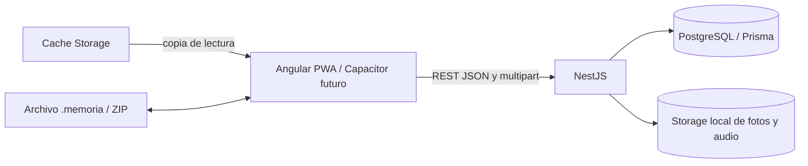
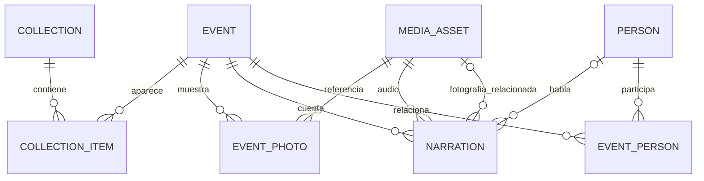

# Arquitectura y plan — Memoria Viva 1.0

Este documento implementa el alcance congelado de [MVP_SPEC.md](MVP_SPEC.md). La app se centra en colecciones, recuerdos, carrusel de fotos, personas y narraciones; no tiene editor de páginas.

## 1. Arquitectura



- **Web:** Angular 20+, Angular Material y service worker PWA. La misma app corre en desktop y móvil; Capacitor queda fuera de esta entrega.
- **API:** NestJS modular con validación DTO. `auth`, `collections`, `events`, `people`, `media` y `health` son los módulos activos. Una cookie HttpOnly identifica al usuario.
- **Datos:** PostgreSQL con Prisma. Colecciones, recuerdos y personas tienen propietario; las consultas filtran por cuenta. Los bytes no se guardan en la base; `MediaAsset.storageKey` es una clave relativa.
- **Medios:** proveedor local durante desarrollo bajo `var/uploads/{photos,audio,thumbnails}`. La abstracción de storage permite una implementación futura S3.
- **Offline:** Cache Storage guarda la respuesta de colección, portada, eventos y medios para lectura sin red. Al cerrar sesión se limpian los medios privados y sus URL locales. No hay cola local de escritura ni sincronización.
- **Portabilidad:** `.memoria` es ZIP con manifiesto, JSON y archivos originales, incluida la portada opcional. V2 omite páginas y hashes cada medio; el importador mantiene compatibilidad con paquetes V1 y descarta su `pages.json` antiguo.

## 2. Estructura del monorepo

```text
LifeMemoryCode/
├── apps/
│   ├── web/
│   │   ├── public/                   # iconos y manifest de la PWA
│   │   └── src/app/
│   │       ├── core/
│   │       │   ├── api/              # cliente REST y URL base
│   │       │   ├── archive/           # importación/exportación .memoria
│   │       │   └── offline/           # caché y medios descargados
│   │       ├── features/
│   │       │   ├── library/           # búsqueda y colecciones
│   │       │   ├── collections/       # formulario y detalle
│   │       │   ├── events/            # alta unificada de recuerdo
│   │       │   ├── reader/            # lectura, carrusel y edición in situ
│   │       │   └── import-export/      # importar archivo portable
│   │       ├── app.routes.ts
│   │       └── app.config.ts
│   └── api/
│       ├── prisma/
│       │   ├── schema.prisma
│       │   └── migrations/
│       └── src/
│           ├── common/                # serialización de BigInt
│           ├── prisma/
│           └── modules/
│               ├── health/
│               ├── collections/
│               ├── events/
│               ├── people/
│               └── media/
├── docs/
├── var/uploads/{photos,audio,thumbnails}/
├── .env.example
├── docker-compose.yml
└── package.json
```

## 3. Modelo de datos activo



| Entidad | Datos principales |
|---|---|
| `User` | Nombre, apellidos, fecha de nacimiento, país, correo y hash de contraseña |
| `Collection` | Propietario, título, tipo (`ALBUM`, `TIMELINE`, `EDUCATIONAL`), descripción y portada opcional |
| `CollectionItem` | Relación colección-recuerdo y posición |
| `Event` | Título, historia, fecha y lugar |
| `EventPerson` / `Person` | Personas guardadas y recuerdos asociados |
| `EventPhoto` | Foto, orden, pie opcional y asset |
| `Narration` | Audio, título, voz/persona, transcripción opcional y foto opcional relacionada |
| `MediaAsset` | Tipo MIME, tamaño, hash, claves relativas para original y miniatura |

La primera migración también contiene columnas y modelos heredados de páginas, categorías, etiquetas, rango de fecha y coordenadas. Se conservan en la base local para no eliminar datos preexistentes, pero ya no forman parte de los DTO, consultas, rutas ni pantallas activas de V1.0. No se necesita una migración destructiva para cambiar la experiencia.

## 4. API REST inicial

Base: `/api/v1`.

| Verbo | Endpoint | Función |
|---|---|---|
| `GET` | `/health` | API y base de datos disponibles |
| `POST` | `/auth/register` | Crear cuenta e iniciar sesión |
| `POST` | `/auth/login` | Iniciar sesión |
| `GET` | `/auth/me` | Consultar sesión actual |
| `POST` | `/auth/logout` | Cerrar sesión |
| `GET`, `POST` | `/collections` | Listar y crear colecciones |
| `GET`, `PATCH`, `DELETE` | `/collections/:id` | Consultar, editar y borrar colección |
| `POST`, `DELETE` | `/collections/:id/events` y `/collections/:id/events/:eventId` | Vincular o quitar recuerdo |
| `PATCH` | `/collections/:id/events/order` | Reordenar recuerdos |
| `GET`, `POST` | `/events?search=&collectionId=` | Buscar o crear (requiere `collectionId`) |
| `GET`, `PATCH`, `DELETE` | `/events/:id` | Consultar, editar o borrar recuerdo |
| `GET`, `POST` | `/people` | Listar y guardar personas por nombre |
| `PATCH`, `DELETE` | `/people/:id` | Editar o borrar persona sin borrar recuerdos ni audios |
| `POST`, `DELETE` | `/collections/:id/cover` | Guardar o quitar portada |
| `POST`, `PATCH`, `DELETE` | `/events/:id/photos` | Subir, actualizar pie o quitar foto |
| `PATCH` | `/events/:id/photos/order` | Guardar el orden del carrusel |
| `POST`, `PATCH`, `DELETE` | `/events/:id/narrations` | Añadir, ordenar o borrar narración |
| `GET` | `/media/assets/:id/content` | Leer original de foto/audio |
| `GET` | `/media/assets/:id/thumbnail` | Leer miniatura WebP |

Fotos: JPEG, PNG, WebP o GIF hasta 25 MB. Audio: MP3, M4A, WAV, OGG o WebM hasta 100 MB. Los límites se validan en API.

## 5. Entorno y Prisma

`.env.example` es la plantilla; `.env` no se versiona. Configura PostgreSQL local, `DATABASE_URL`, `PORT`, `CORS_ORIGIN`, `AUTH_SECRET` y `MEDIA_ROOT`. `AUTH_SECRET` debe ser una clave aleatoria local de al menos 32 caracteres. Prisma 7 usa `apps/api/prisma.config.ts`; las migraciones SQL versionadas se aplican con `npm run db:migrate:deploy`.

```powershell
Copy-Item .env.example .env
npm install
docker compose up -d postgres
npm run db:generate
npm run db:migrate:deploy
npm run dev:api
npm run dev:web
```

En desarrollo, una migración nueva se genera con `npm run db:migrate:dev`.

## 6. PWA y uso offline

Al solicitar una descarga, el servicio lee una colección y sus recuerdos, conserva JSON, originales de fotos/audio y miniaturas en Cache Storage, y actualiza el índice de colecciones descargadas al completar. El progreso representa metadatos y archivos. Al quitar una descarga se preservan URLs que usan otras colecciones.

La app shell offline depende del service worker de producción. En desarrollo normal Angular desactiva el worker; se puede usar `npm run start:web:production` para abrir el build PWA local. El acceso offline requiere que el navegador mantenga sus datos del sitio.

## 7. Archivo `.memoria`

```text
manifest.json       format, versión, fecha de exportación y SHA-256
collection.json     título, tipo, descripción y portada opcional
events.json         datos de recuerdos, personas, fotos y voces
media/<uuid>        originales de fotos y audio
```

El exportador crea ZIP sin compresión para no reprocesar archivos grandes. El importador valida extensión, versión, rutas, tamaño y hash antes de crear contenido. Si una operación falla, intenta eliminar la colección y recuerdos recién creados. Importa V1 (que podía incluir páginas) y V2; en la V1 ignora las páginas históricas.

## 8. Sprints y plan de desarrollo

| Sprint | Trabajo | Estado de salida esperado |
|---|---|---|
| S0 — Base y cuenta | Compose, PostgreSQL, Prisma, Nest, registro/login y aislamiento por usuario | Desarrollo local y biblioteca privada operativos |
| S1 — Colecciones | Biblioteca, formulario, portada, detalle y orden | Colección navegable con imagen opcional |
| S2 — Recuerdos | Crear desde el lector, vista previa de fotos y catálogo de personas editable | Alta unificada en la misma vista de lectura |
| S3 — Lectura | Carrusel, visor a pantalla completa, audio editable, navegación estable y guardar/salir de edición | Recuerdo legible y adaptable |
| S4 — Offline | Descarga de datos, portada y medios; limpieza al cerrar sesión | Lectura sin red y datos privados retirados al salir |
| S5 — Portabilidad | `.memoria` V2 con portada, compatibilidad V1 y pulido responsive | Import/export recuperable |

## 9. Verificación y trabajo posterior

Antes de declarar V1 lista, recorrer manualmente la creación y edición de recuerdo, varias fotos, el visor a pantalla completa y sus flechas/cierre, varias voces, PWA offline, retirar copia, exportar e importar. La compilación se verifica con `npm run build:api` y `npm run build:web`.

Quedan fuera de este plan activo: AWS, colaboración, editor de páginas, IA, transcripción automática y APK Capacitor. Se considerarán después de validar V1 con recuerdos reales.
